# PDF Scout User Guide

PDF Scout is a small, fast PDF reader for Windows from Dialsoft. It opens PDFs, finds and copies text, prints, and lets you move, delete and combine pages. This guide covers version 1.7.0.

**Prefer to watch?** A three-minute narrated video tour covers the same ground, including an animated demonstration of combining two PDFs: [watch it on dialsoft.com](https://dialsoft.com/pdf-scout/#video).

## Contents

1. [Getting PDF Scout](#1-getting-pdf-scout)
2. [The window at a glance](#2-the-window-at-a-glance)
3. [Opening and reading a PDF](#3-opening-and-reading-a-pdf)
4. [Finding text](#4-finding-text)
5. [Selecting and copying text](#5-selecting-and-copying-text)
6. [Printing](#6-printing)
7. [Moving and deleting pages](#7-moving-and-deleting-pages)
8. [Taking pages from one PDF into another](#8-taking-pages-from-one-pdf-into-another)
9. [Saving your changes](#9-saving-your-changes)
10. [Sending a PDF to someone](#10-sending-a-pdf-to-someone)
11. [Settings](#11-settings)
12. [Updates](#12-updates)
13. [Keyboard shortcuts](#13-keyboard-shortcuts)
14. [If something isn't working](#14-if-something-isnt-working)
15. [For IT: installing without clicking](#15-for-it-installing-without-clicking)

---

## 1. Getting PDF Scout

PDF Scout runs on 64-bit Windows 10 and Windows 11. It comes two ways, and both are the same program. Download either one from the [PDF Scout download page](https://github.com/Dialsoft/pdfscout-releases).

| Download | Choose it when |
|---|---|
| **PDFScout-Setup.exe** (installer) | You want PDF Scout in the Start menu and in Windows' list of installed apps, with an uninstaller. |
| **PDFScout.exe** (portable) | You want one file you can keep on your Desktop, in a tools folder, or on a USB stick. Nothing is installed. |

**The installer** asks one question: who PDF Scout is for.

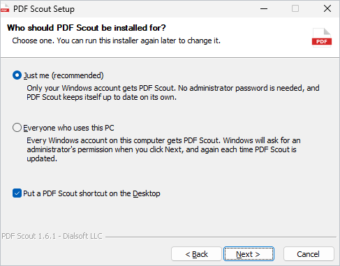

- **Just me** installs PDF Scout for your Windows account only. No administrator password is needed.
- **Everyone who uses this PC** installs it for every account on the computer. Windows asks for an administrator's permission when you click Next, and again each time PDF Scout updates.

**The portable copy** has no setup. Put `PDFScout.exe` somewhere like your Desktop or `C:\Tools` and double-click it. Don't put it in Program Files, because it couldn't update itself there.

**"Windows protected your PC."** Windows may show a blue box with this message the first time you run either download. Click **More info**, then **Run anyway**.

**Making PDF Scout open your PDFs.** Open PDF Scout, go to the **Settings** tab and click **Set as default PDF app**. Windows makes you confirm the choice yourself, so PDF Scout opens the right Windows screen and tells you what to click.

**Removing PDF Scout.** For an installed copy, use Windows Settings > Apps > Installed apps > PDF Scout > Uninstall. For the portable copy, delete `PDFScout.exe`.

---

## 2. The window at a glance

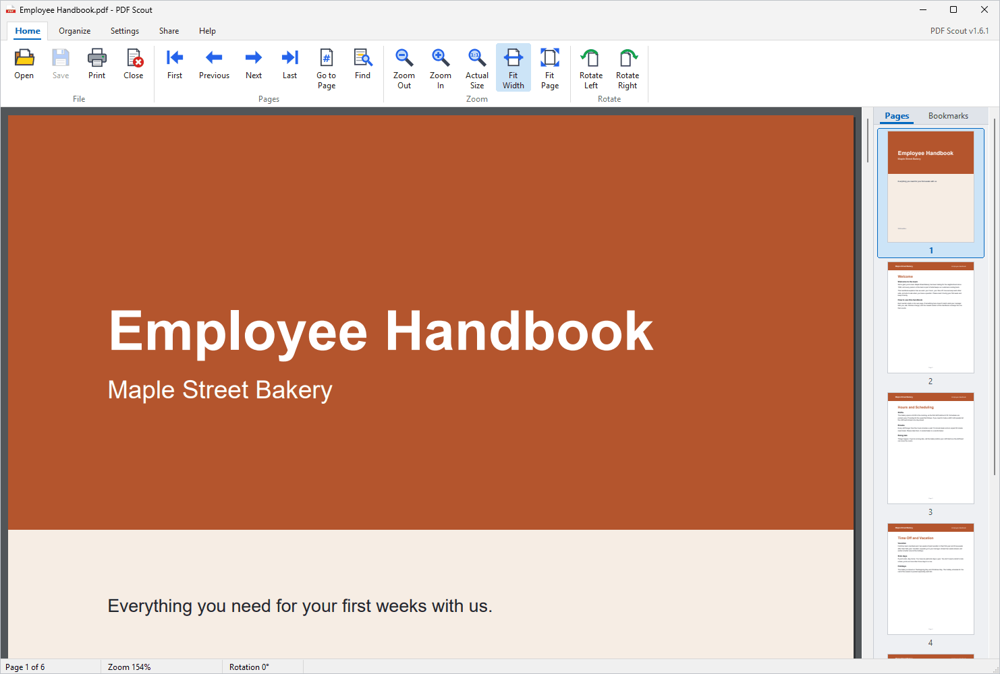

- **The ribbon** across the top holds the buttons, in five tabs: **Home**, **Organize**, **Settings**, **Share** and **Help**.
- **The page** you're reading is in the middle.
- **The side panel** on the right shows a small picture of every page. Click one to jump to that page. Press **F4** to hide or show the panel.
- **The status bar** along the bottom shows the page number, the zoom, and a short message about what just happened.

**Every button explains itself.** Rest the mouse on any button for a moment and a description appears, in plain English, with the keyboard shortcut if there is one.

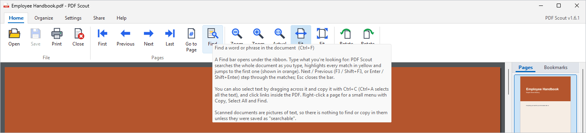

---

## 3. Opening and reading a PDF

**To open a PDF**, do any of these:

- Click **Open** on the Home tab, or press **Ctrl+O**.
- Drag a PDF from File Explorer onto the PDF Scout window.
- Double-click a PDF, once PDF Scout is your default PDF app (see section 1).

If the PDF has a password, PDF Scout asks for it.

**Moving around**

- Scroll with the mouse wheel, the scroll bar, Page Up and Page Down, the space bar, or the arrow keys.
- **Previous** and **Next** (or the Left and Right arrow keys) jump a whole page. **First** and **Last** (or Home and End) go to the ends.
- **Go to Page** (Ctrl+G) jumps to a page number.
- Click a page in the side panel to jump straight to it.
- When the page is bigger than the window, click an empty part of it and drag to move it around.

**Zoom**

- **Zoom In** and **Zoom Out**, or hold Ctrl and roll the mouse wheel.
- **Fit Width** fills the window from side to side. **Fit Page** shows one whole page. **Actual Size** shows the real paper size.

**Rotate.** **Rotate Left** and **Rotate Right** turn every page a quarter turn, which is handy for sideways scans. This only changes how the PDF is shown and printed in PDF Scout. The file itself is not changed.

### Quick Read: flipping through a folder of PDFs

Quick Read lets you go through the PDFs in a folder one after another, the way the Photos app goes through pictures. It's the fast way to look through a folder of invoices, scans or statements.

1. Open any PDF in the folder.
2. Press **F11**. (Or click **Quick Read** on the Organize tab, or right-click the page and choose Quick Read.)
3. Press the **Right arrow** key for the next PDF in the folder, and the **Left arrow** key for the previous one. You can also click the round arrows at the left and right edges of the page.
4. Press **Esc** (or F11 again, or click **Exit Quick Read** in the top right corner) when you're done. Everything comes back the way it was.

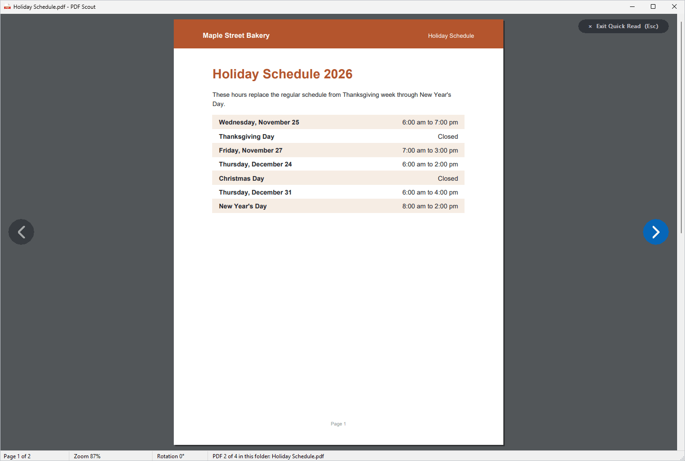

While you're in Quick Read:

- The ribbon and the side panel step aside so the page gets the whole window, and each PDF is shown fitted to the window.
- **Up / Down**, **Page Up / Page Down** and the mouse wheel still move through the pages of the PDF you're looking at.
- The status bar shows where you are, such as "PDF 3 of 12 in this folder".
- The PDFs come in name order, the way File Explorer sorts names (so "Invoice 2" comes before "Invoice 10").
- Pages can't be moved or deleted. Leave Quick Read first.

**Without Quick Read**, **Ctrl+Right** and **Ctrl+Left** jump to the next and previous PDF in the folder too.

**Bookmarks.** Some PDFs have their own table of contents. Click **Bookmarks** at the top of the side panel, then click a heading to jump to that part of the document. The part you're reading is highlighted. If the word Bookmarks is gray, this PDF doesn't have any.

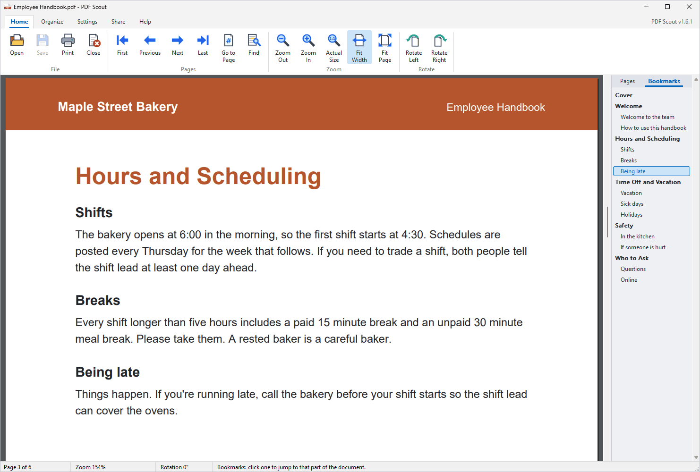

**Links.** Links inside a PDF work. Click one to jump to the page it points to. A link to a website shows you the real address and asks before it opens your browser.

---

## 4. Finding text

1. Click **Find** on the Home tab, or press **Ctrl+F**. A Find bar opens under the ribbon.
2. Type a word or phrase. PDF Scout searches the whole document as you type.
3. Every match is highlighted in yellow. The one you're on is orange, and the bar shows a count such as "1 of 4".
4. Press **Enter** or **F3** for the next match, **Shift+Enter** or **Shift+F3** for the previous one.
5. Press **Esc** to close the Find bar.

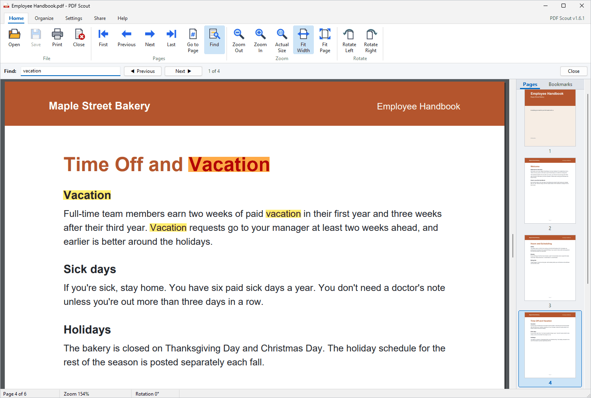

Capital and small letters are treated the same.

**Find finds nothing in a scanned document?** A scan is a picture of text, so there are no letters to search unless it was saved as "searchable" by the scanner or scanning program.

---

## 5. Selecting and copying text

- **Drag across text** to select it. It turns blue.
- **Double-click** a word to select just that word.
- **Shift+click** extends the selection to where you clicked.
- **Ctrl+A** selects all the text in the document. (If you last clicked in the side panel, Ctrl+A selects all the pages there instead; click on the page first.)
- **Ctrl+C** copies what's selected, ready to paste into an email or document.

Right-click a page for a small menu with **Copy**, **Select All** and **Find**.

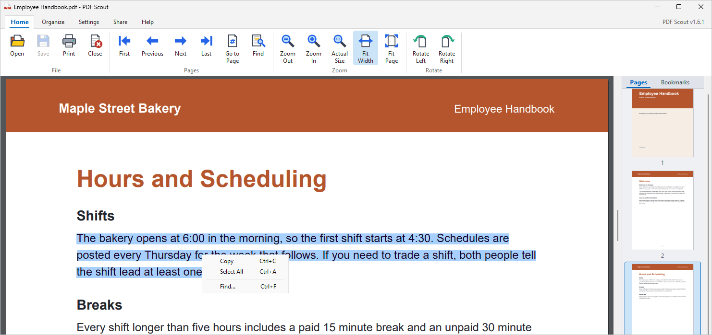

To unselect, click an empty part of the page or press Esc.

---

## 6. Printing

1. Click **Print** on the Home tab, or press **Ctrl+P**.
2. Pick your printer.
3. Choose **All**, **Current Page**, or **Pages** with a range such as `1-3,7`.
4. Click **Print**.

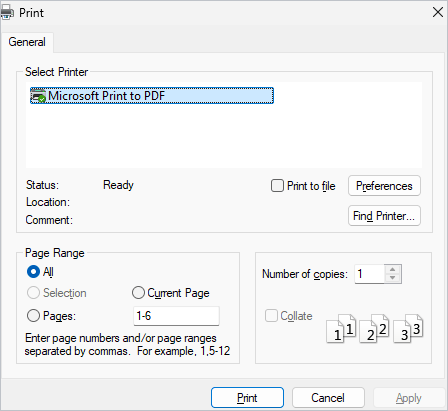

The **Settings** tab controls how pages fit the paper, the print quality, and whether sideways pages are turned to match the paper. See section 11.

---

## 7. Moving and deleting pages

Page changes are made on the **Organize** tab and in the side panel. Nothing changes in the PDF file until you click **Save** (section 9), so you can experiment freely.

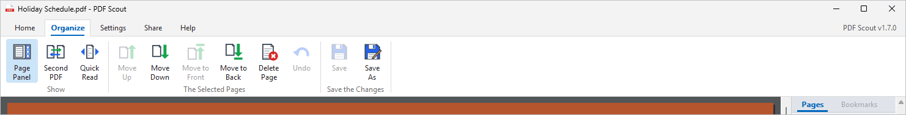

### Moving a page

**By dragging:** in the side panel, press on a page's picture and drag it up or down. A blue bar shows where it will land. Let go to drop it there.

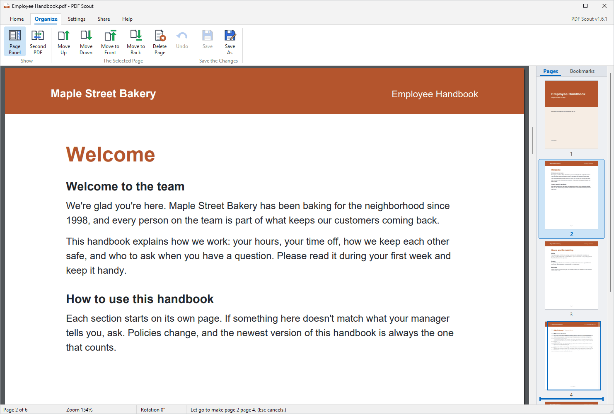

- Drag near the top or bottom edge of the panel and the list scrolls by itself.
- Press **Esc** while dragging to cancel.

**With the buttons:** click a page in the side panel to select it, then click **Move Up**, **Move Down**, **Move to Front** or **Move to Back** on the Organize tab.

After a move, the status bar says what happened and a star (`*`) appears in front of the file name in the title bar. The star means there are changes you haven't saved yet.

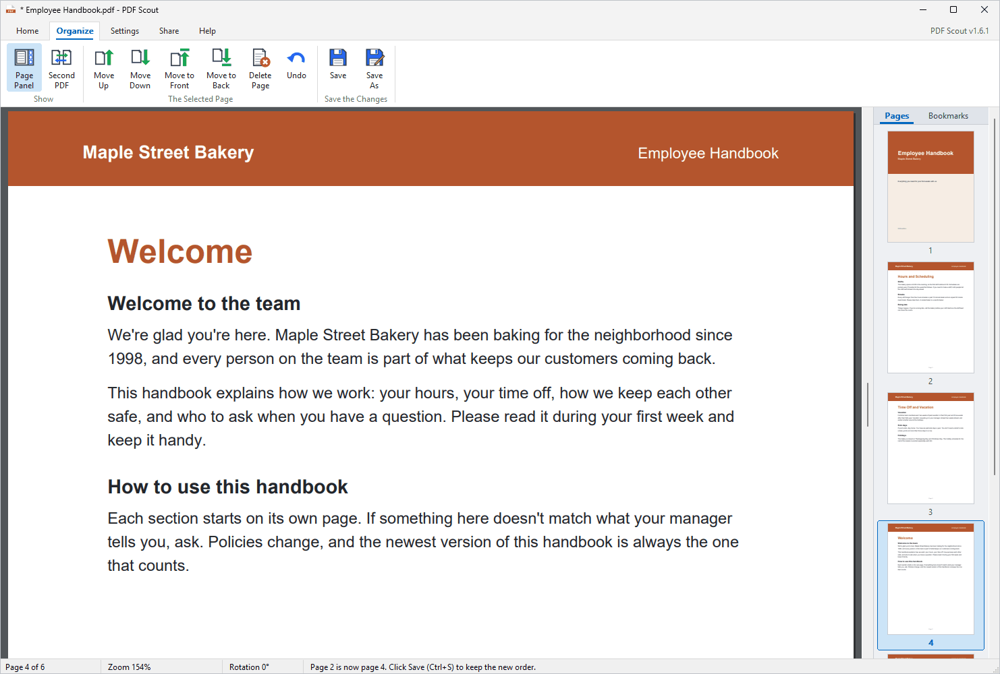

### Working with several pages at once

You can select several pages in the side panel and then move, delete or copy them all together. It works the way selecting files does in File Explorer:

| To select | Do this |
|---|---|
| One page | Click it. |
| More pages, one at a time | Hold **Ctrl** and click each one. Ctrl+click a selected page again to take it out. |
| A run of pages | Click the first one, then hold **Shift** and click the last one. Every page in between is selected too. |
| Every page | Click any page in the side panel, then press **Ctrl+A**. |

Selected pages are highlighted in blue, and the status bar says how many there are. Press **Esc** to go back to one page.

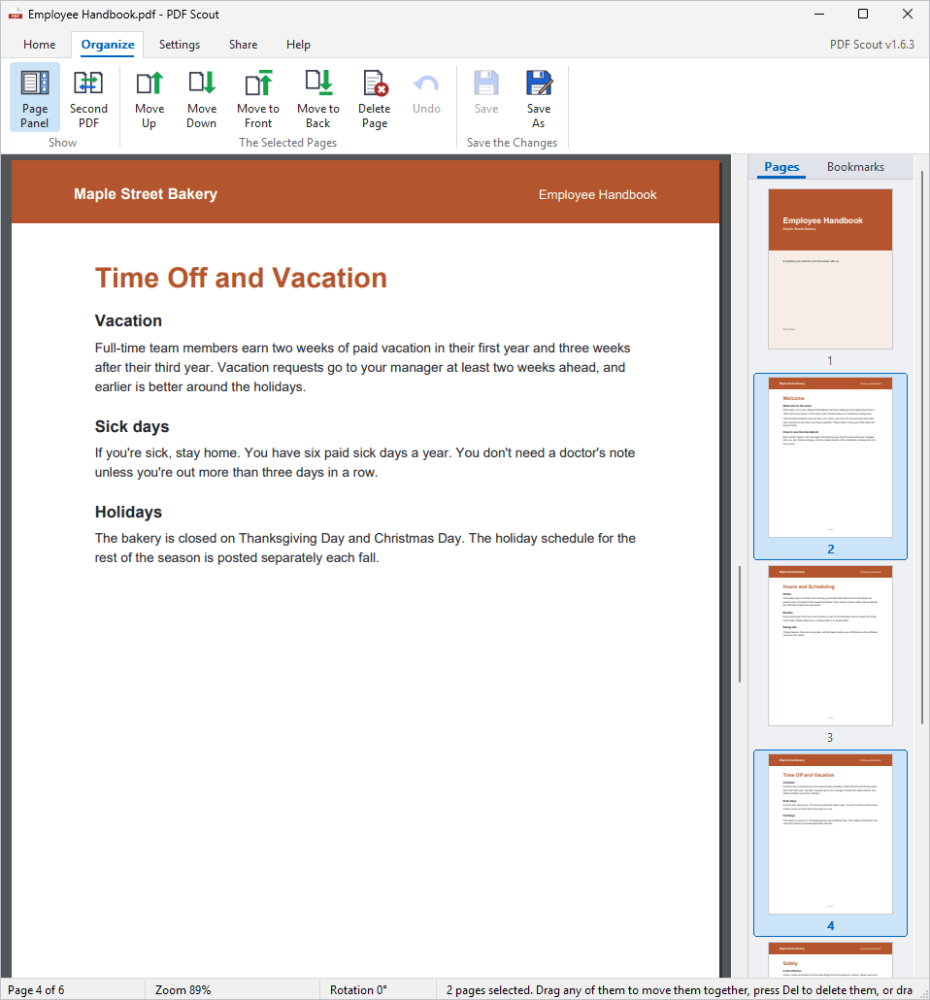

With several pages selected:

- **Drag any of them** and they all move together, in their order. A small number on the page you're dragging shows how many are coming along.
- **Del**, **Delete Page**, the **Move** buttons and the right-click menu work on all of them.
- **Ctrl+Z** takes the whole change back in one step.

### Deleting a page

Select the page in the side panel (or several pages, as above), then do any of these:

- Press **Del**.
- Click **Delete Page** on the Organize tab.
- Right-click the page in the side panel and choose **Delete This Page**.

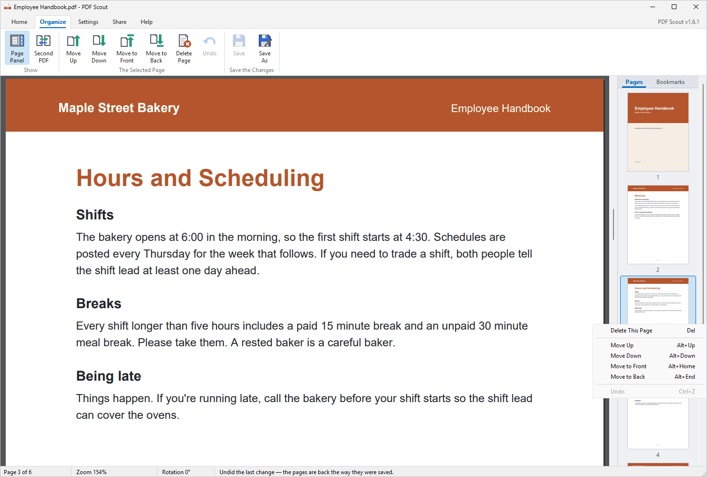

A PDF always keeps at least one page, so the last page can't be deleted.

### Undo

**Undo** on the Organize tab, or **Ctrl+Z**, takes back the last change: a move, deleted pages, or pages you brought in from another PDF. A change to several pages at once is taken back in one step. Click it again to take back the change before that, all the way to how the PDF was when you opened or last saved it.

Undo only works on changes that haven't been saved.

---

## 8. Taking pages from one PDF into another

To combine PDFs, open each one in its own PDF Scout window and drag pages between them.

### Step 1: open the second PDF

On the **Organize** tab, click **Second PDF** and pick the other file. PDF Scout moves the window you have to the left half of the screen and opens the other PDF in the right half.

Any two PDF Scout windows work, however you opened them. Second PDF just saves you arranging them.

### Step 2: drag a page across

Press on a page in one window's side panel, drag it over the other window's side panel, and let go. A small picture of the page travels with the mouse, and a blue bar in the other window shows where the page will land.

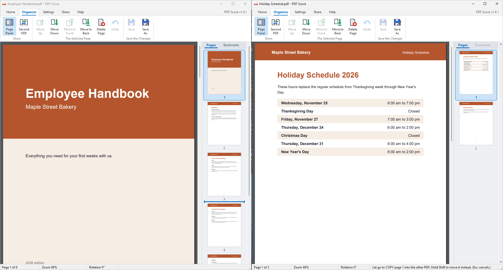

- **A plain drag copies the page.** It stays in the PDF it came from.
- **Hold Shift while you let go to move it instead.** It is added to the other PDF and deleted from the one it came from.
- It works in both directions.
- If you let go over the other window's page area instead of its side panel, the page is added at the end.
- **To take several pages at once**, select them first with Ctrl+click, Shift+click or Ctrl+A (see section 7), then drag any one of them. They arrive together, in order, and stay selected in the other window so you can see what came in.

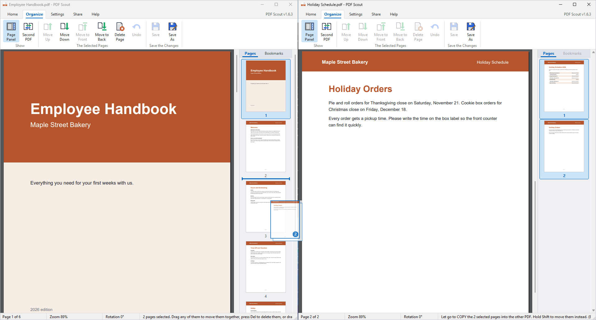

### Step 3: save, or Save As to make a new PDF

You have two choices in the window that received the page:

- **Save As** writes the combined result to a **new PDF** with a name you choose. Both original files are left exactly as they were. This is the way to build a new document out of pages from others.
- **Save** changes the PDF you have open.

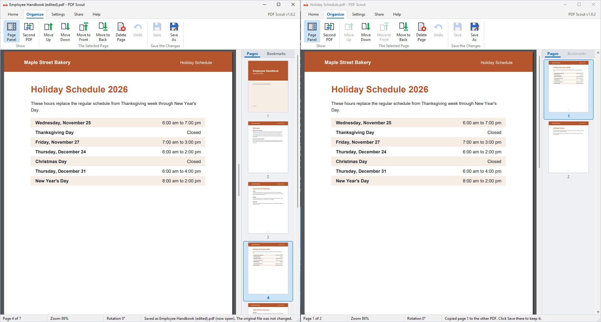

After a Shift move, the window the page left has changes too, so save there as well. Until you do, nothing in that file has changed.

**What comes across.** A page brought in from another PDF keeps its pictures, text, links and notes. It does not bring that PDF's bookmarks or fillable-form behavior. The PDF receiving the page keeps its own bookmarks.

---

## 9. Saving your changes

- **Save** (Ctrl+S) writes your page changes into the PDF file you have open.
- **Save As** (Ctrl+Shift+S) writes them to a new file and leaves the original exactly as it was. PDF Scout then switches to the new file.

**Saving is careful.** PDF Scout writes the new file next to the old one, reads it back to check every page, and only then replaces the old file. If anything goes wrong along the way, your original is left untouched and your changes stay on screen so you can try Save As.

**Deleted pages are really gone.** Once you save, a deleted page is removed from the file, not just hidden. If you might want the original again, use **Save As**.

**Closing with unsaved changes.** If you close the PDF or PDF Scout while the star is showing, PDF Scout asks whether to save first.

**Password-protected PDFs** can be read and printed, but their pages can't be changed and they can't be used as the source of pages for another PDF.

---

## 10. Sending a PDF to someone

The **Share** tab sends the PDF you're reading, or a short note about PDF Scout, to another person.

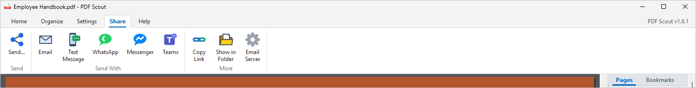

1. Click **Send** (or go straight to **Email**, **Text Message**, **WhatsApp**, **Messenger** or **Teams**).
2. Pick a saved person or type a new one.
3. Choose what to send, check the message, and click **Send**.

How each one works:

- **Email:** PDF Scout sends the email itself through your mail server, with the PDF attached. Set up the server once with **Email Server** on the Share tab.
- **Text Message:** PDF Scout opens Phone Link, types the number and message, and presses Send. Keep your hands off the mouse and keyboard for a few seconds while it works. Phone Link must already be set up with your phone. Text messages can't carry PDF files.
- **WhatsApp, Messenger, Teams:** PDF Scout opens a chat with the person. If you're sending the PDF, press Ctrl+V in the chat to paste it.

**Copy Link** copies the PDF Scout download link. **Show in Folder** opens File Explorer with the PDF selected.

---

## 11. Settings

Every setting takes effect the moment you change it. There is nothing to restart.

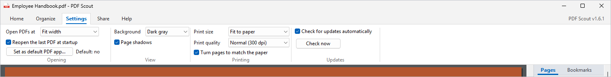

| Setting | What it does |
|---|---|
| **Open PDFs at** | How a newly opened PDF is zoomed: fit width, fit page, or actual size. |
| **Reopen the last PDF at startup** | PDF Scout starts with the PDF you had open last time, at the same page. |
| **Set as default PDF app** | Makes PDF Scout open PDFs when you double-click them. Windows asks you to confirm. |
| **Background** | The color behind the pages. |
| **Page shadows** | A soft shadow under each page. |
| **Print size** | Fit each page to the paper, or print at actual size. |
| **Print quality** | Higher quality is sharper and takes longer to print. |
| **Turn pages to match the paper** | Sideways pages are rotated so they fill the sheet. |
| **Check for updates automatically** | PDF Scout looks for a new version when it starts and every 6 hours. |
| **Check now** | Looks for a new version right away. |

---

## 12. Updates

PDF Scout checks for a new version when it starts and every 6 hours. When one is available, a yellow bar appears under the ribbon.

- **Update now** downloads the new version, checks it, and restarts PDF Scout with the same PDF open at the same page.
- **What's new** shows what changed.
- **Later** hides the bar for now.

A copy installed for everyone on the PC asks for an administrator's permission each time it updates. If your IT department switched automatic updates off when it installed PDF Scout, they look after updates for you.

**Help** tab > **Release Notes** lists what changed in every version.

---

## 13. Keyboard shortcuts

| Keys | What they do |
|---|---|
| Ctrl+O | Open a PDF |
| Ctrl+P | Print |
| Ctrl+W | Close the PDF |
| Ctrl+S | Save page changes |
| Ctrl+Shift+S | Save As |
| Ctrl+F | Find |
| F3 / Shift+F3 | Next / previous match |
| Ctrl+C | Copy the selected text |
| Ctrl+G | Go to a page number |
| Home / End | First / last page |
| Left / Right arrow | Previous / next page |
| Ctrl+Plus / Ctrl+Minus | Zoom in / out |
| Ctrl+mouse wheel | Zoom |
| Ctrl+0 | Fit page |
| Ctrl+1 | Actual size |
| Ctrl+2 | Fit width |
| Ctrl+L / Ctrl+R | Rotate left / right |
| F4 | Show or hide the side panel |
| F11 | Quick Read on or off |
| Left / Right arrow in Quick Read | Previous / next PDF in the folder |
| Ctrl+Left / Ctrl+Right | Previous / next PDF in the folder (anytime) |
| Alt+Up / Alt+Down | Move the selected page(s) earlier / later |
| Alt+Home / Alt+End | Move the selected page(s) to the front / back |
| Del | Delete the selected page or pages |
| Ctrl+click a page | Add it to the selection, or take it out (side panel) |
| Shift+click a page | Select every page from the last one clicked (side panel) |
| Ctrl+A | Select all the text; after clicking in the side panel, select all the pages |
| Esc | Go back to one selected page; close the Find bar; leave Quick Read |
| Ctrl+Z | Undo the last page change |
| F1 | The built-in How to Use help |

---

## 14. If something isn't working

**Find finds nothing, and text can't be selected.**
The PDF is probably a scan, which is a picture of text. See section 4.

**"The pages of this PDF can't be rearranged."**
The PDF is password protected, or is built in a way PDF Scout won't risk changing. You can still read, print and send it.

**Save says it couldn't replace the file.**
The file may be read-only, in a protected folder, or open in another program. Your changes are still on screen. Use **Save As** and pick another name or folder, such as Documents.

**Find, copy, links and bookmarks are all missing.**
PDF Scout has a built-in PDF engine that it unpacks the first time it runs. If your antivirus blocks that, PDF Scout falls back to the engine built into Windows, which shows and prints pages but can't do those things. Help tab > **Diagnostic Report** says which engine is in use.

**Something else.**
Click **Diagnostic Report** on the Help tab right after the problem happens. It writes a text file called `PDF Scout diagnostics.txt` to your Desktop and copies the same text to the clipboard, so you can paste it into an email to whoever supports you.

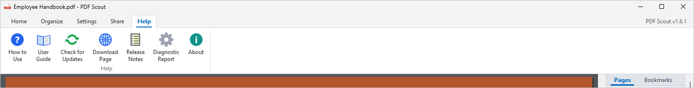

---

## 15. For IT: installing without clicking

`PDFScout-Setup.exe` accepts these switches. `/S` must be a capital S.

| Command | What it does |
|---|---|
| `PDFScout-Setup.exe /S` | Installs silently for the account running it |
| `PDFScout-Setup.exe /S /ALLUSERS` | Installs silently for everyone (run it as administrator) |
| add `/DESKTOP` | Also creates a Desktop shortcut |
| add `/NOUPDATES` | Switches off automatic update checks, for PCs you update yourself |
| add `/D=C:\Folder` | Installs into that folder (must be last on the line, without quotes) |
| `"C:\Program Files\PDF Scout\Uninstall.exe" /S` | Uninstalls silently |

The installer returns 0 when it succeeds.

To update a PC where automatic updates are off, run the new `PDFScout-Setup.exe` with the same switches over the existing copy.

---

© 2026 Dialsoft LLC. PDF Scout includes the PDFium library; its license notices are in [THIRD-PARTY-NOTICES.txt](THIRD-PARTY-NOTICES.txt).
